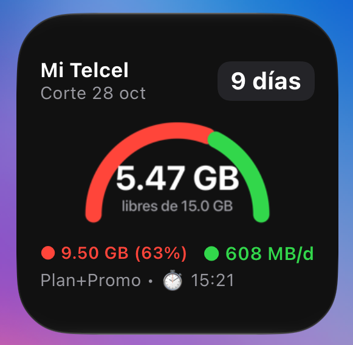

# Widgets de Consumo Móvil para iOS y Android (Telcel, Bait y Movistar)

Widgets para iOS que muestran en tiempo real los **GB disponibles combinados (Plan Base + Datos Promocionales)**, el **consumo acumulado**, los **días restantes** y la **siguiente fecha de corte/vigencia** de tu línea **Mi Telcel**, **Mi Bait** o **Mi Movistar**.

<p align="center">
  
</p>

---

## Características

- **Soporte multi-operador (Scriptable):** Scripts independientes y listos para usar en [`src/MiTelcelWidget.js`](src/MiTelcelWidget.js) (**Telcel**), [`src/MiBaitWidget.js`](src/MiBaitWidget.js) (**Bait**, consulta directa sin contraseña) y [`src/MiMovistarWidget.js`](src/MiMovistarWidget.js) (**Movistar**, login interactivo con WebView por reCAPTCHA v3 y desencriptado AES-256-GCM).
- **Validación interactiva de credenciales:** Valida tus credenciales en vivo contra la API del operador antes de guardarlas en el Keychain; detecta errores de captura y problemas de conectividad con reintento guiado.
- **Suma inteligente de bolsas:** Combina automáticamente los datos del Plan Base y los Datos Promocionales/Bonos vigentes en una sola pasada eficiente.
- **Fecha de corte y vigencia:** Muestra los días restantes y la fecha de corte o vigencia exacta reportada por el operador (recalculada dinámicamente al leer desde caché).
- **Medidor semicircular y presupuesto diario:** Arco bicolor (rojo gastado vs. verde disponible), porcentaje usado (`%`) y cálculo de ritmo diario disponible (`MB/d` o `GB/d`).
- **Almacenamiento seguro:** Las credenciales y tokens nunca se guardan en texto plano; se almacenan en el **Keychain de iOS** aislados por dispositivo.
- **Caché y desconexión segura:** Guarda la última consulta en caché para carga instantánea y revoca el token SSO de Telcel al terminar para evitar bloqueos por sesiones concurrentes.
- **Recuperación táctil de errores:** Estado visual con icono de advertencia (`⚠️`) y copy accionable ante fallos de conexión o sesión expirada; tocar el widget abre el script en Scriptable (`scriptable:///run`) para resolverlo en un toque.
- **Dos métodos de uso:**
  1. **Scriptable:** Sin Mac, sin Xcode, listo en 2 minutos desde el iPhone.
  2. **Nativo WidgetKit / SwiftUI:** Proyecto Xcode completo con app contenedora y widget para iOS 17+.

---

## Método 1: Instalación vía Scriptable (Recomendado, Sin Mac)

Instala y ejecuta el widget en tu iPhone directamente sin necesidad de cuenta de desarrollador ni computadora.

### 1. Instalar Scriptable
Descarga la app gratuita **[Scriptable](https://apps.apple.com/app/scriptable/id1405459188)** desde la App Store en tu iPhone.

### 2. Copiar el código del Widget
1. Según tu operador, abre el archivo correspondiente en este repositorio:
   - **Telcel:** [`src/MiTelcelWidget.js`](src/MiTelcelWidget.js)
   - **Bait:** [`src/MiBaitWidget.js`](src/MiBaitWidget.js)
   - **Movistar:** [`src/MiMovistarWidget.js`](src/MiMovistarWidget.js)
2. Copia todo su contenido al portapapeles de tu iPhone (puedes usar el Portapapeles Universal de Apple, AirDrop, o enviártelo por mensaje).

### 3. Crear el script en Scriptable
1. Abre **Scriptable** en tu iPhone.
2. Pulsa el botón **`+`** en la esquina superior derecha para crear un nuevo script.
3. Toca el título en la parte superior (dice *Untitled Script*) y cámbialo a **`MiTelcel`**, **`MiBait`** o **`MiMovistar`**.
4. Pega el código copiado dentro del editor.
5. Pulsa **Done** en la esquina superior izquierda.

### 4. Configurar tus datos por primera vez
1. Abre nuevamente el script (**MiTelcel**, **MiBait** o **MiMovistar**) dentro de Scriptable.
2. Pulsa el botón **Play (▶)** en la esquina inferior derecha.
3. Se iniciará la configuración guiada con **validación previa en vivo**:
   - **En Mi Telcel:** Ingresa tu **número a 10 dígitos** y tu **contraseña de Mi Telcel**. El script valida la autenticación ante el servicio SSO oficial (y revoca de inmediato el token de prueba) antes de guardar los datos en Keychain.
   - **En Mi Bait:** Ingresa únicamente tu **número Bait a 10 dígitos** (no requiere contraseña). Se verifica la línea contra el API de Altán antes de guardarla.
   - **En Mi Movistar:** Se abrirá una ventana de navegador (WebView) en `mi.movistar.com.mx/login`. Inicia sesión normalmente para superar el reCAPTCHA v3; el widget capturará el token `p_id` (`ec_auth`), validará el acceso al consumo con su llave `guardKey` y lo guardará en el Keychain para las siguientes actualizaciones en segundo plano.
4. Si ingresaste un dato incorrecto o hay una falla de red, el script te avisará de inmediato y te permitirá reintentar sin guardar credenciales inválidas.
5. Tras la validación, el script ejecutará la consulta y mostrará la vista previa del widget. Pulsa **Done**.

### 5. Agregar el Widget a tu Pantalla de Inicio
1. Ve a la pantalla de inicio de tu iPhone.
2. Mantén presionada cualquier área vacía hasta que los íconos comiencen a temblar.
3. Toca el botón **`+`** en la esquina superior izquierda.
4. Busca y selecciona **Scriptable**.
5. Elige el tamaño **Pequeño (Small)** y toca **Agregar widget**.
6. Mientras los íconos sigan temblando, toca el widget recién agregado (o mantenlo presionado y selecciona **Editar widget**).
7. En el campo **Script**, selecciona **`MiTelcel`**, **`MiBait`** o **`MiMovistar`**.
8. En **When Interacting** (Al interactuar), selecciona **Run Script** (Ejecutar script).
9. Toca fuera del widget para guardar. ¡Listo! El widget se actualizará periódicamente.

> [!TIP]
> Si el widget alguna vez pierde conexión o requiere renovar sesión (por ejemplo en Movistar), mostrará un estado de advertencia (`⚠️`) y al tocarlo se abrirá automáticamente en Scriptable para resolverlo en un toque.

### 6. Restablecer credenciales o cambiar de línea (Resetear contraseña)
Gracias a la validación previa en vivo, el widget evita guardar credenciales o números inválidos durante la configuración inicial. Si cambiaste tu contraseña en el portal de la operadora, cambiaste de número o deseas registrar otra cuenta:
1. Crea un nuevo script en Scriptable y nómbralo **`ResetearPassword`** (o **`resetear password`**).
2. Pega el código de [`src/ResetearPassword.js`](src/ResetearPassword.js).
3. Ejecútalo pulsando **Play (▶)** y elige el operador a restablecer (o **Todos**):
   - **Mi Telcel:** borra `TELCEL_PHONE` y `TELCEL_PASS`.
   - **Mi Bait:** borra `BAIT_PHONE`.
   - **Mi Movistar:** borra el token de sesión `MOVISTAR_PID`.
4. Vuelve a abrir el script del operador (**`MiTelcel`**, **`MiBait`** o **`MiMovistar`**) y pulsa **Play (▶)** para ingresar tus nuevos datos (en Movistar se abrirá otra vez el login en WebView).

---

## Método 2: Compilación Nativa en Xcode (`WidgetKit` / SwiftUI)

Para usuarios con Mac y Xcode que deseen compilar la app y extensión nativa:

1. Abre `MiTelcelWidget.xcodeproj` en **Xcode 15+ / 16+**.
2. En la pestaña **Signing & Capabilities** de los targets `MiTelcelApp` y `MiTelcelWidgetExtension`, selecciona tu equipo (*Personal Team* o *Apple Developer Program*) y ajusta el `Bundle Identifier` si es necesario.
3. Conecta tu iPhone, habilita el **Modo de desarrollador** en *Ajustes > Privacidad y seguridad*.
4. Compila y ejecuta el esquema `MiTelcelApp` (`Cmd + R`).
5. Abre la app en el iPhone, ingresa tus credenciales y pulsa **Actualizar Consumo Ahora**.
6. Añade el widget nativo **MiTelcelWidget** desde el menú de widgets de iOS.

---

## Método 3: Prototipo para Android (Termux:Widget / KWGT)

> [!WARNING]
> **Nota:** Como no cuento con un teléfono Android físico, **los scripts de Android no han sido probados en hardware real**. Comparten exactamente los mismos parsers y flujos de red de iOS (`src/MiTelcelWidget.js`, `src/MiBaitWidget.js` y `src/MiMovistarWidget.js`), pero se incluyen únicamente como referencia experimental.

1. Instala **Termux** y **Termux:Widget** desde **F-Droid**, luego instala Node.js y Git:
   ```sh
   pkg update && pkg install -y nodejs git
   termux-setup-storage
   ```
2. Clona este repositorio en Termux y configura tu archivo `.env` (credenciales para Telcel, Bait y/o Movistar):
   ```sh
   cp .env.example .env
   nano .env
   ```
3. Copia los lanzadores que necesites a `~/.shortcuts/` para usar con **Termux:Widget** (`MiTelcel`, `MiBait`, `MiMovistar`), o lee los archivos JSON correspondientes generados en `/sdcard/Download/` (`mitelcel_widget.json`, `mibait_widget.json`, `mimovistar_widget.json`) desde **KWGT**.
4. Consulta la guía completa de configuración y fórmulas KWGT en [`android/README.md`](android/README.md).

---

## Pruebas y Validación desde Terminal (macOS)

### 1. Suite de Pruebas Automatizadas (Offline / Mocks)
Valida en un solo comando todos los parsers JS (Telcel, Bait y Movistar con descifrado AES-256-GCM simulado), validación interactiva de credenciales y red, renderizado `DrawContext`, resumen Android y parser nativo Swift:
```sh
node tests/test_parser.mjs
```

### 2. Validación de Endpoints en Vivo con Telcel
Puedes probar las llamadas reales y verificar el formato devuelto por Mi Telcel usando el script automatizado:

1. Copia `.env.example` a `.env` y configura tus credenciales:
   ```zsh
   cp .env.example .env
   ```
2. Ejecuta el probe seguro (revoca la sesión SSO al terminar):
   ```zsh
   zsh .agents/skills/telcel-api-probe/scripts/probe_telcel.sh
   ```
3. El reporte con el desglose de bolsas se guardará en `artifacts/probe_report.txt`.

---

## Estructura del Repositorio

```text
.
├── assets/
│   └── widget_preview.png          # Captura del widget en pantalla de inicio
├── src/
│   ├── MiTelcelWidget.js           # Widget autónomo Mi Telcel para Scriptable (iOS)
│   ├── MiBaitWidget.js             # Widget autónomo Mi Bait para Scriptable (iOS)
│   ├── MiMovistarWidget.js         # Widget autónomo Mi Movistar para Scriptable (iOS)
│   └── ResetearPassword.js         # Script para limpiar credenciales de Telcel, Bait o Movistar en Keychain
├── tests/
│   └── test_parser.mjs             # Suite de pruebas unitarias (Telcel, Bait, Movistar, Keychain, UI y Swift)
├── android/
│   ├── mitelcel_widget.mjs         # Prototipo Node.js para Mi Telcel (Termux / KWGT)
│   ├── mibait_widget.mjs           # Prototipo Node.js para Mi Bait (Termux / KWGT)
│   ├── mimovistar_widget.mjs       # Prototipo Node.js para Mi Movistar (Termux / KWGT)
│   ├── shortcuts_mitelcel.sh       # Lanzador Telcel para Termux:Widget (~/.shortcuts)
│   ├── shortcuts_mibait.sh         # Lanzador Bait para Termux:Widget (~/.shortcuts)
│   ├── shortcuts_mimovistar.sh     # Lanzador Movistar para Termux:Widget (~/.shortcuts)
│   └── README.md                   # Guía de configuración y fórmulas KWGT en Android
├── MiTelcelApp/
│   └── MiTelcelApp.swift           # App contenedora iOS (SwiftUI)
├── MiTelcelWidget/
│   ├── TelcelNetworkService.swift  # Cliente SSO + JWT + Parser Wave B2F
│   ├── MiTelcelWidget.swift        # Extensión WidgetKit y TimelineProvider
│   └── Info.plist                  # Configuración de extensión WidgetKit
├── MiTelcelWidget.xcodeproj/       # Proyecto Xcode (iOS 17+)
├── .agents/skills/telcel-api-probe/
│   ├── SKILL.md                    # Skill para pruebas de API Telcel
│   └── scripts/probe_telcel.sh     # CLI de autenticación y extracción de esquema
├── Telcel Widget API.md            # Especificación técnica del API Wave B2F (Telcel)
├── Mexican Carriers Widget API.md  # Especificación de APIs para Bait, AT&T y Movistar
├── API Validation.md               # Guía de validación manual con curl
└── Research.md                     # Bitácora técnica y arquitectura de endpoints
```

---

## Seguridad y Privacidad

- **Sin servidores intermediarios:** Las peticiones viajan directamente desde tu iPhone a los servidores oficiales de cada operador:
  - **Telcel:** `wbl.telcel-id.com`, `mi-telcel.smapps.mx`, `api.journeys.telcel.wavebybemobi.com`.
  - **Bait:** `mibait.com` (consulta directa por número a través del proxy Ordenaris/Altán, sin contraseña).
  - **Movistar:** `mi.movistar.com.mx` (login interactivo en WebView y consulta de consumos cifrados con AES-256-GCM).
- **Validación previa:** Credenciales y tokens se verifican directamente contra los servidores del operador antes de persistirse en el dispositivo.
- **Keychain de iOS:** Contraseñas, números y tokens (`p_id` de Movistar) se almacenan mediante el subsistema de seguridad de iOS (`Keychain`) con protección por dispositivo (`kSecAttrAccessibleAfterFirstUnlockThisDeviceOnly`), nunca en texto plano en el código.
- **Descubrimiento dinámico de llaves con respaldo auditado:** Los tokens y llaves públicas de servicio (`MTL_AUTHORIZATION_BASIC`, `x-ord-service`, `guardKey`) se descubren dinámicamente de los portales web oficiales y cuentan con valores de respaldo estáticos públicos auditados (`Sec-Safe`), emitiendo advertencias en consola si se requiere fallback.
- **Revocación de sesión obligatoria (Telcel):** Cada consulta de Telcel (incluyendo la validación inicial de credenciales) revoca activamente el token SSO generado (`/sso/revoke`), evitando bloqueos por inicios de sesión simultáneos en la app oficial. Bait no abre sesión; Movistar reutiliza el `p_id` guardado hasta su expiración.
